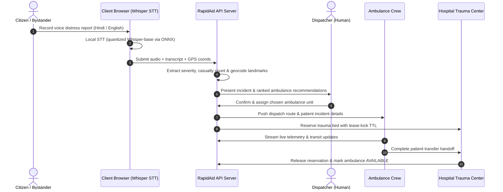
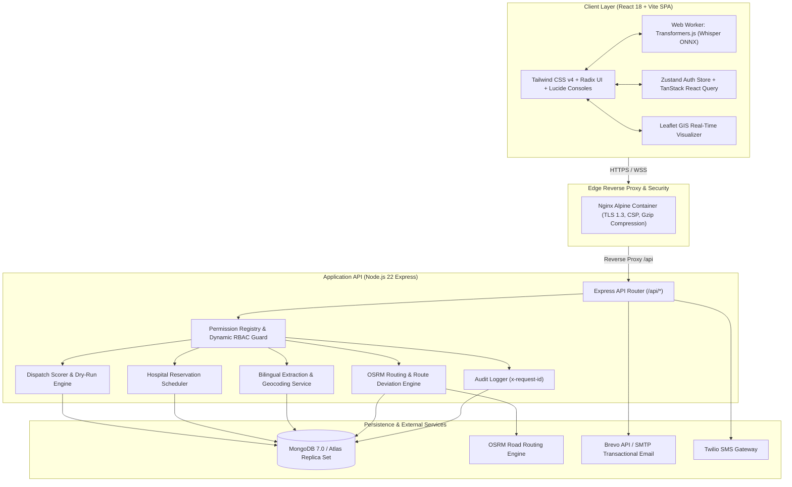

# RapidAid — AI-Assisted Emergency Response & Intelligent Dispatch Coordination Network

> **Smarter coordination. Faster emergency response.**

[](https://nodejs.org/)
[](https://www.typescriptlang.org/)
[](https://react.dev/)
[](https://vitejs.dev/)
[](https://expressjs.com/)
[](https://www.mongodb.com/)
[](https://tailwindcss.com/)
[](https://huggingface.co/docs/transformers.js)
[](https://vitest.dev/)
[](LICENSE)

RapidAid is a web-based emergency response coordination prototype designed to integrate emergency reporting, on-device AI-assisted speech processing, intelligent ambulance recommendation, human-in-the-loop dispatch assignment, live response tracking, road routing support, and hospital bed coordination into a unified, reliable software workflow.

---

## 🌐 Live Deployments & Project Links

- **Live Web Application (Frontend)**: [https://rapidaid-web.onrender.com](https://rapidaid-web.onrender.com)
- **Backend API Service**: [https://rapidaid-api-vpms.onrender.com](https://rapidaid-api-vpms.onrender.com)
- **Source Code Repository**: [https://github.com/shivam123yadav/RapidAid](https://github.com/shivam123yadav/RapidAid)
- **Project Type**: Academic & Demonstration Prototype
- **Team**: Shivam Yadav & Yash Kumar (Yash Jaiswal)

---

## 📌 Table of Contents

- [Overview & Objectives](#-overview--objectives)
- [Problem Statement](#-problem-statement)
- [How RapidAid Works](#-how-rapidaid-works)
- [Key Features](#-key-features)
- [System Architecture](#-system-architecture)
- [Emergency Lifecycle State Machine](#-emergency-lifecycle-state-machine)
- [Role-Based Access Control (RBAC)](#-role-based-access-control-rbac)
- [AI Voice & Speech-to-Text Pipeline](#-ai-voice--speech-to-text-pipeline)
- [Repository Structure](#-repository-structure)
- [Quick Start & Local Development](#-quick-start--local-development)
  - [Prerequisites](#prerequisites)
  - [Installation & First-Time Setup](#installation--first-time-setup)
  - [Demo Accounts Matrix](#demo-accounts-matrix)
- [Testing & Quality Assurance](#-testing--quality-assurance)
- [Deployment & Operations](#-deployment--operations)
  - [Docker & Containerized Run](#docker--containerized-run)
  - [Render Staging & Cloud Hosting](#render-staging--cloud-hosting)
  - [Backups & Disaster Recovery](#backups--disaster-recovery)
- [Limitations & Future Scope](#-limitations--future-scope)
- [Safety & Medical Disclaimer](#-safety--medical-disclaimer)
- [Core Engineering Team](#-core-engineering-team)
- [Documentation Catalog](#-documentation-catalog)

---

## 🚑 Overview & Objectives

Emergency response coordination often involves multiple fragmented handoffs:

$$\text{Report} \longrightarrow \text{Understand} \longrightarrow \text{Recommend} \longrightarrow \text{Assign} \longrightarrow \text{Respond} \longrightarrow \text{Coordinate} \longrightarrow \text{Complete}$$

When these steps occur through disconnected systems, response teams suffer from information loss, delayed dispatches, and misallocated hospital resources. RapidAid addresses these challenges through a unified digital platform where:

1. **Citizens** report emergencies via text or on-device multilingual voice.
2. **On-Device Whisper** converts speech to text locally in the browser with zero cloud dependencies.
3. **Clinical NLP** extracts structured triage severity, casualties, and geocoded landmarks.
4. **Intelligent Scoring** evaluates proximity, equipment tier (ALS/BLS), crew fatigue, and hospital trauma capabilities.
5. **Human Dispatchers** retain strict, final override control over all unit assignments.
6. **Ambulance Crews** receive turn-by-turn routing (OSRM) and hospital destination details on mobile-friendly interfaces.
7. **Hospitals** receive pre-arrival alerts and manage lease-based trauma bed reservations.
8. **Green Corridors** simulate traffic preemption along the route to minimize transit time.

---

## ❗ Problem Statement

Emergency response systems face critical operational bottlenecks:
- **Unstructured Distress Reports**: Emergency calls are often frantic, incomplete, or spoken in regional languages (e.g., Hindi/Hinglish).
- **Manual Ambulance Selection**: Dispatchers face cognitive overload when manually matching unit availability, equipment tiers, and route congestion during peak crises.
- **Disconnected Hospital Handoffs**: Emergency rooms often learn of critical trauma arrivals only when the ambulance pulls up to the bay.
- **Absence of Unified Lifecycles**: Disparate tools for CAD (Computer-Aided Dispatch), GPS tracking, and patient intake create visibility blind spots.

RapidAid solves these problems by connecting every stakeholder through a cohesive, state-driven workflow backed by human-in-the-loop decision support.

---

## 🔄 How RapidAid Works



---

## ✨ Key Features

### 1. Edge AI Multilingual Voice Reporting
- **100% Offline Browser STT**: Employs `@huggingface/transformers` with quantized `Xenova/whisper-base` running on ONNX Runtime WebAssembly. Speech-to-text runs entirely on the caller's machine without external cloud API dependencies.
- **Bilingual Clinical Extraction**: Server-side normalization parses Hindi, English, and Hinglish phrasing to categorize incident types (Cardiac, Road Accident, Respiratory, Trauma), estimate victim counts, and resolve landmarks (e.g., Gwalior Fort, Rajpath) into geographic coordinates.

### 2. Intelligent Ambulance & Hospital Recommendation
- **Multi-Factor Ranking Algorithm**: Evaluates candidate ambulances using road distance (OSRM), crew duty hours, equipment capability (Advanced Life Support vs. Basic Life Support), and hospital bed availability.
- **Explainable Scoring**: Provides dispatchers with explicit mathematical breakdowns and a dry-run preview before confirming any dispatch.

### 3. Human-in-the-Loop Dispatch Guard
- **Strict Operational Safety**: RapidAid enforces a fail-fast backend invariant: automated dispatch without human validation is rejected (`AUTOMATED_DISPATCH_ENABLED=false`). The dispatcher always verifies recommendations.

### 4. Concurrency-Safe Hospital Bed Reservations
- **Lease-Based Locking**: Holds trauma and ICU beds for incoming critical patients using distributed locks with automatic TTL expiration to prevent double-booking or stale holds.

### 5. Live Fleet Telemetry & Road Routing
- **Real-Time GPS Ingestion**: Validates coordinates, tracks vehicle velocity, logs breadcrumbs, and alerts dispatchers upon route deviation.
- **Turn-by-Turn Guidance**: Powered by self-hosted Open Source Routing Machine (OSRM) with simulated offline fallbacks.

### 6. Traffic Preemption "Green Corridor" Simulation
- **Signal Coordination**: Simulates dynamic traffic light preemption along critical transit paths, giving ambulances clear passage during time-sensitive Code-3 emergencies.

### 7. Dual-Token Authentication & Enterprise Auditability
- **Cryptographic Security**: 15-minute in-memory JWTs combined with 7-day rotating SHA-256 hashed refresh tokens stored in `httpOnly`, `SameSite` cookies.
- **Traceable Audit Log**: Every state change, assignment, export, and authorization attempt is permanently logged with an `x-request-id`.

---

## 🏛️ System Architecture



---

## 🔄 Emergency Lifecycle State Machine

RapidAid models emergencies through a strict forward-only finite state machine to guarantee data integrity:

```
[ REPORTED ] ──(Triage / AI Review)──► [ DISPATCHED ]
                                             │
                                   (Ambulance En Route)
                                             ▼
                                      [ EN_ROUTE ]
                                             │
                                     (Arrival On Scene)
                                             ▼
                                      [ ON_SCENE ]
                                             │
                                   (Transport to Hospital)
                                             ▼
                                     [ IN_TRANSIT ]
                                             │
                                    (Hospital Handoff)
                                             ▼
                                      [ COMPLETED ]
                                             ▲
      [ CANCELLED ] ◄──(Prior to Scene)──────┘
```

- **Terminal States**: `COMPLETED` and `CANCELLED` are immutable once reached.
- **Resource Recovery**: Transitioning to a terminal state automatically releases assigned ambulances back to `AVAILABLE` status and marks reserved hospital beds as occupied or released.

---

## 👥 Role-Based Access Control (RBAC)

RapidAid implements a fine-grained, permission-based authorization architecture. User roles are dynamically resolved against the permission registry on every request:

| Role | Core Responsibilities | Typical Console Views | Key Permissions |
|---|---|---|---|
| **`CITIZEN`** | Emergency SOS reporting, tracking personal reports | `/emergencies`, `/voice` | `emergency:create`, `emergency:view:own`, `voice:record` |
| **`DISPATCHER`** | Triage incoming queue, compare recommendations, assign units | `/command-center`, `/dispatch`, `/cameras` | `ambulance:assign`, `ambulance:view`, `camera:live-view` |
| **`AMBULANCE_CREW`** | Navigate to scene, update patient vitals, broadcast GPS | `/tracking`, `/emergencies/:id` | `ambulance:telemetry`, `ambulance:view:own`, `emergency:status` |
| **`HOSPITAL_STAFF`** | Monitor incoming arrivals, update bed and trauma capacity | `/hospitals` | `hospital:update-capacity`, `hospital:view` |
| **`SUPERVISOR`** | Global operational oversight, override dispatches, review alerts | `/command-center`, `/alerts` | `emergency:override`, `ambulance:status`, `audit:view` |
| **`ANALYST`** | Evaluate fleet response times, identify bottleneck trends | `/analytics`, `/reports` | `report:generate`, `report:export`, `analytics:view` |
| **`AUDITOR`** | Inspect immutable event records, review CCTV evidence | `/audit`, `/cameras` | `audit:view`, `camera:evidence-export`, `report:export` |
| **`ADMIN`** | System configuration, user provisioning, database health | `/admin/users`, `/admin/permissions` | `user:manage`, `system:configure`, `maintenance:manage` |

---

## 🎙️ AI Voice & Speech-to-Text Pipeline

The voice pipeline delivers reliable, privacy-first transcription without external cloud APIs:

1. **Client-Side Speech-to-Text (`src/lib/useVoiceInput.ts`)**:
   - Audio is recorded at 16 kHz mono WAV via the Web Audio API.
   - An isolated Web Worker loads `@huggingface/transformers` and runs `Xenova/whisper-base` quantized with ONNX Runtime WebAssembly (`public/ort/`).
   - Transcription completes in ~1.5–3 seconds completely offline on consumer-grade hardware.
2. **Server-Side Clinical NLP (`server/src/services/emergencyExtractionService.ts`)**:
   - The transcript is processed by bilingual extractors (`hindiNormalizationService.ts`).
   - Extracts:
     - **Triage Priority**: `CRITICAL` (Code Red), `URGENT` (Code Yellow), or `NON_URGENT` (Code Green).
     - **Incident Category**: Road Accident, Cardiac Arrest, Respiratory Distress, Fire/Burn, Stroke, etc.
     - **Casualties**: Total count detected from numerals or regional language terms.
     - **Geocoding**: Matches location descriptions to GIS landmarks via `geocodingService.ts`.
3. **Dispatcher Review**:
   - The structured draft is displayed in `VoiceRecordingReview.tsx` for dispatcher verification before ticket creation.

---

## 📁 Repository Structure

```
RapidAid/
├── .github/                 # GitHub Actions CI/CD workflows
├── docs/                    # Architecture and operational manuals
│   ├── deployment/          # AWS Student / Cloud deployment guides
│   ├── security/            # Cryptographic standards and key rotation
│   ├── DEPLOYMENT.md        # Comprehensive production deployment architecture
│   ├── ENVIRONMENT.md       # Complete environment variable reference catalog
│   ├── RENDER_DEPLOYMENT.md # Render staging blueprint guide
│   └── RUNBOOK.md           # Production operations and disaster recovery runbook
├── fixtures/                # Benchmark speech fixtures and audio samples
├── public/                  # Static assets
│   ├── models/              # Quantized Whisper ONNX weights (~42 MB)
│   └── ort/                 # OnnxRuntime-Web WebAssembly workers (~42 MB)
├── scripts/                 # Root utilities and AI verification scripts
│   ├── backup-db.mjs        # Database snapshot engine with AWS S3 sync
│   ├── restore-db.mjs       # Non-destructive disaster recovery restoration drill
│   ├── sync-voice-model.mjs # Whisper model and WASM bundler
│   └── verify-whisper-pipeline.mjs # Offline STT transcription verifier
├── server/                  # Backend Express 5 + TypeScript + Mongoose service
│   ├── scripts/             # Admin bootstrapping, GPS simulation, index builder
│   ├── src/
│   │   ├── authz/           # Permission registry and RBAC guards
│   │   ├── config/          # Zod environment validation and Pino logging
│   │   ├── db/              # Mongoose connection and lifecycle probes
│   │   ├── models/          # 11 Mongoose domain models with JSON transforms
│   │   ├── routes/          # REST endpoints mounted under /api
│   │   ├── services/        # Dispatch, Voice, Routing, Hospital, and Notification engines
│   │   └── index.ts         # Server entrypoint and graceful shutdown handling
│   ├── tests/               # 125+ Vitest integration and security regression tests
│   ├── Dockerfile           # Multi-stage production Alpine backend image
│   └── README.md            # Backend-specific architecture and API reference
├── src/                     # Frontend React 18 + Vite + Tailwind CSS application
│   ├── api/                 # Typed API client and session management
│   ├── components/          # Radix UI primitives, Leaflet maps, Voice player, Layout
│   ├── hooks/               # Custom React hooks (voice, geolocation, themes)
│   ├── pages/               # Operational consoles for all 8 system roles
│   ├── stores/              # Zustand stores (Auth, Theme, Navigation)
│   └── App.tsx              # Role-gated client routes and error boundaries
├── docker-compose.yml       # Base multi-container setup (Mongo, API, Client)
├── docker-compose.prod.yml  # Production container hardening overlay
├── Dockerfile               # Multi-stage frontend Vite build + Nginx edge image
├── nginx.conf               # Hardened reverse proxy configuration with CSP & Gzip
├── package.json             # Root workspace definitions and orchestrator scripts
├── render.yaml              # Staging deployment blueprint for Render
└── vite.config.js           # Vite development server configuration & proxy
```

---

## 🚀 Quick Start & Local Development

### Prerequisites
- **Node.js**: `v22.0.0` or higher
- **MongoDB**: `v6.0` or higher (running locally on `mongodb://127.0.0.1:27017`)
- **Package Manager**: `npm` v10+

### Installation & First-Time Setup

1. **Clone the repository**:
   ```bash
   git clone https://github.com/shivam123yadav/RapidAid.git
   cd RapidAid
   ```

2. **Install root and server dependencies**:
   ```bash
   npm install
   npm run server:install
   ```

3. **Configure Environment Variables**:
   Copy the example environment files:
   ```bash
   cp .env.example .env
   cp server/.env.example server/.env
   ```

4. **Sync the Offline Voice Model**:
   Download and cache the Whisper ONNX model and WASM runtime files locally:
   ```bash
   npm run prepare:voice-model
   ```

5. **Seed Demo Data**:
   Populate the local database with ambulances, hospitals, simulated incidents, and demo accounts:
   ```bash
   npm run server:seed
   ```
   *(Optional: Use `npm run server:seed:gwalior` for specialized Gwalior GIS coordinates.)*

6. **Start Development Servers**:
   Launch the system using two terminals:

   ```bash
   # Terminal 1: Backend API (http://localhost:5000)
   npm run server

   # Terminal 2: Frontend Web App (http://localhost:3000)
   npm run dev
   ```

The Vite dev server automatically proxies all `/api` requests to `http://localhost:5000`, eliminating CORS restrictions in development.

---

### Demo Accounts Matrix

The database seeder provisions accounts representing all operational roles. Each account shares the default demo password: `demo123`.

| Role | Email Address | Password | Primary Console |
|---|---|---|---|
| **Dispatcher** | `dispatcher@rapidaid.com` | `demo123` | `/dispatch`, `/command-center` |
| **Ambulance Crew** | `crew@rapidaid.com` | `demo123` | `/tracking`, `/emergencies` |
| **Hospital Staff** | `hospital@rapidaid.com` | `demo123` | `/hospitals` |
| **Supervisor** | `supervisor@rapidaid.com` | `demo123` | `/command-center`, `/dispatch` |
| **Administrator** | `admin@rapidaid.com` | `demo123` | `/admin/users`, `/admin/permissions` |
| **Auditor** | `auditor@rapidaid.com` | `demo123` | `/audit`, `/reports` |
| **Analyst** | `analyst@rapidaid.com` | `demo123` | `/analytics` |
| **Citizen** | `citizen@rapidaid.com` | `demo123` | `/emergencies`, `/voice` |

> [!TIP]
> Use the **Demo Roles Gallery** (`/demo-roles`) or the quick-login buttons on the `/login` screen to switch between personas with a single click.

---

## 🧪 Testing & Quality Assurance

RapidAid maintains a comprehensive test suite across unit, integration, and end-to-end browser layers:

```bash
# Frontend TypeScript strict check
npm run typecheck

# Frontend Vitest unit test suite
npm run test

# 125+ Backend API integration test suites (requires local MongoDB)
npm run server:test

# Verify on-device offline Whisper speech transcription pipeline
npm run verify:whisper

# Live audio ingestion test against running API server
npm run server:e2e:voice

# Full headless Chrome end-to-end voice workflow (Playwright)
npm run server:verify:ui-flow
```

### Headless Chrome Voice Flow (`npm run server:verify:ui-flow`)
This end-to-end suite drives a live headless Chrome session:
1. Logs into the application with dispatcher credentials.
2. Streams a synthesized emergency distress call (`server/scripts/ui-tts.wav`) into a virtual WebRTC microphone.
3. Transcribes the audio locally in the browser worker via Whisper ONNX.
4. Posts the report to the backend API, verifying NLP triage extraction and geocoding.
5. Verifies that the emergency was routed to an optimal hospital and plays back the archived audio clip asserting accurate duration and playback controls.

---

## 🌐 Deployment & Operations

### Docker & Containerized Run

RapidAid provides multi-stage production Docker configurations with an Nginx reverse proxy:

```bash
# Build production images
docker compose -f docker-compose.yml -f docker-compose.prod.yml build

# Launch containers in detached mode
docker compose -f docker-compose.yml -f docker-compose.prod.yml --env-file .env.production up -d

# Check service status and health probes
docker compose ps
docker compose logs -f backend
```

### Render Staging & Cloud Hosting
- **Render Staging**: Deploy the entire stack using the root [`render.yaml`](render.yaml) blueprint. For step-by-step setup, see [docs/RENDER_DEPLOYMENT.md](docs/RENDER_DEPLOYMENT.md).
- **AWS Production**: For AWS deployments (EC2 / ECS Fargate + MongoDB Atlas + ACM + OSRM), refer to [docs/deployment/AWS_STUDENT_DEPLOYMENT.md](docs/deployment/AWS_STUDENT_DEPLOYMENT.md).
- **Infrastructure Architecture**: Complete guide on TLS termination, Nginx tuning, and zero-downtime rollbacks in [docs/DEPLOYMENT.md](docs/DEPLOYMENT.md).

### Backups & Disaster Recovery

```bash
# Execute an ad-hoc gzipped logical database backup
npm run backup

# Non-destructive dry-run restore drill
npm run backup:restore:drill

# Complete backup-restore verification
npm run backup:verify

# Rebuild and verify all 11 production MongoDB indexes
npm --prefix server run db:verify-indexes
```

For operational incident response, see the [Operations Runbook (docs/RUNBOOK.md)](docs/RUNBOOK.md).

---

## ⚠️ Limitations & Future Scope

### Limitations
- **Academic & Prototype Scope**: RapidAid is an educational prototype and is not connected to official emergency service lines (e.g., 108 or 112 in India, 911 in the US).
- **Simulated Hardware**: GPS tracking, vehicle telemetry, and traffic signal preemption are software simulations and do not interface with physical vehicle OBD-II / CAN bus hardware or municipal traffic SCADA networks.
- **Synthetic Hospital Data**: Hospital capacity numbers are mock data and not synchronized with live Hospital Information Systems (HIS).

### Future Scope
- **Hardware Telemetry Integration**: Integration with physical OBD-II / AIS-140 GPS tracking devices for live ambulance location updates.
- **Official CAD Integration**: Secure API gateways to interface with official computer-aided dispatch networks (112 / 108).
- **Predictive Ambulance Staging**: Machine learning models for demand forecasting, dynamic standby positioning, and historical traffic-aware ETA modeling.

---

## ⚠️ Safety & Medical Disclaimer

> [!CAUTION]
> **RapidAid is an academic demonstration prototype.** It is **not** a certified medical device, does not replace trained emergency dispatchers, and does not replace official emergency services.
> 
> AI-extracted information and automated recommendations may be incomplete or inaccurate and **must always be reviewed by authorized human personnel**.
> 
> **For a real medical emergency, please call your local emergency services immediately (112 or 108 in India, 911 in the US, 999 in the UK).**

---

## 👨‍💻 Core Engineering Team

RapidAid was conceptualized, architected, and built by:

| Developer | Role & Core Ownership | Focus Areas | Profile |
|---|---|---|---|
| **Shivam Yadav** | **Full-Stack Developer & Cloud Architect**<br>Lead: Backend & Infrastructure | • Core Backend Services & Scalable APIs<br>• Real-Time Dispatch Scoring Engine<br>• Edge AI Voice Processing & NLP Pipeline<br>• Cloud Infrastructure & Security Hardening | [](https://github.com/shivam123yadav) |
| **Yash Kumar**<br>*(Yash Jaiswal)* | **Full-Stack Developer & Systems Engineer**<br>Lead: Frontend & Integrations | • Real-Time Operational Command Consoles<br>• Live Telemetry Map & GPS Visualizer<br>• Turn-by-Turn Road Routing Integration<br>• Multi-Role Operational Workflows & UI/UX | [](https://github.com/Yash-Jaiswal) |

---

## 📚 Documentation Catalog

Detailed operational, architectural, and security manuals are available in the [`docs/`](docs/) directory:

- 📘 [Production Deployment Guide (`docs/DEPLOYMENT.md`)](docs/DEPLOYMENT.md) — Container provisioning, TLS termination, Nginx configuration, and blue-green rollbacks.
- ⚙️ [Environment Variable Catalog (`docs/ENVIRONMENT.md`)](docs/ENVIRONMENT.md) — Comprehensive reference for all configuration options and startup validation invariants.
- 🚀 [Render Staging Walkthrough (`docs/RENDER_DEPLOYMENT.md`)](docs/RENDER_DEPLOYMENT.md) — Guide for standing up a free-tier staging environment on Render.
- 🛠️ [Operations & Disaster Recovery Runbook (`docs/RUNBOOK.md`)](docs/RUNBOOK.md) — Backup procedures, index maintenance, health alerts, and emergency playbooks.
- 🔐 [Key Rotation & Cryptography Standards (`docs/security/KEY_ROTATION.md`)](docs/security/KEY_ROTATION.md) — Guidelines for rotating JWT secrets, database credentials, and API keys.
- 🖥️ [Backend Architecture & API Specification (`server/README.md`)](server/README.md) — Endpoint registry, payload shapes, and service design principles.

---

## 📜 License

This project is licensed under the MIT License — see the [LICENSE](LICENSE) file for details.
