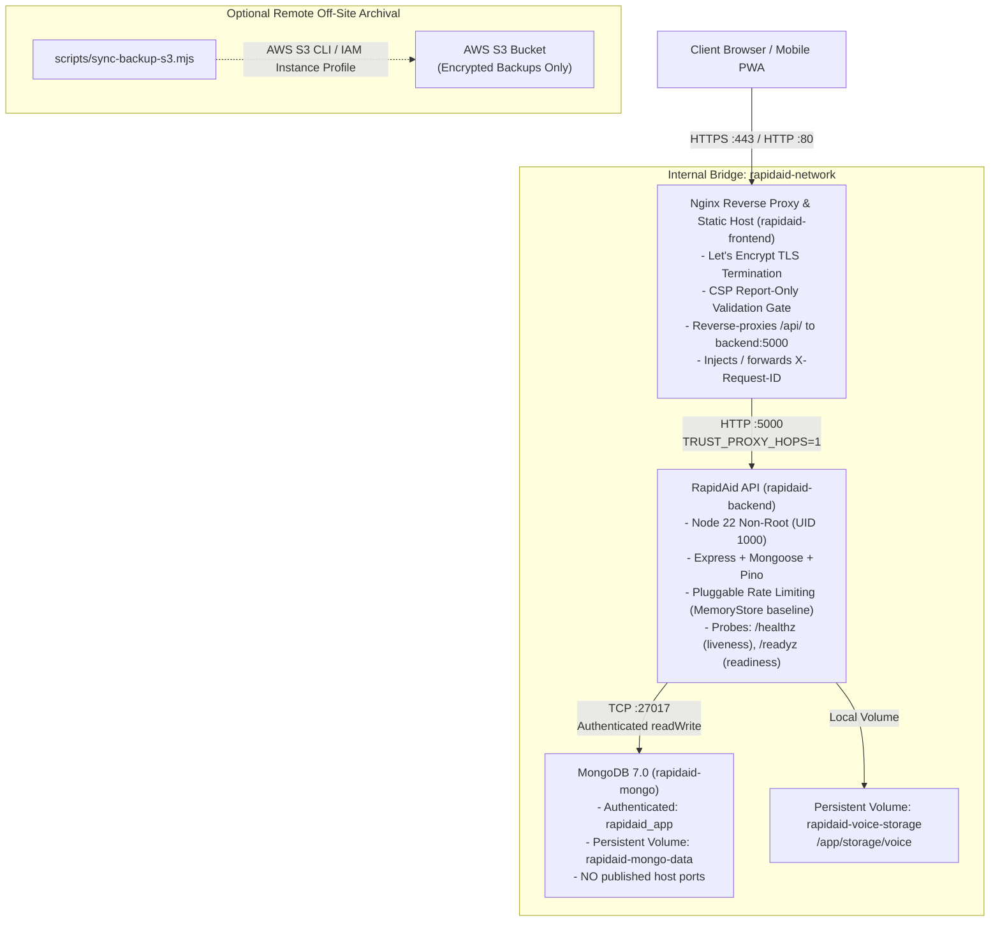

# RapidAid V2 — AWS Deployment & Operations Guide (Student Budget)

**Target Audience:** DevOps Engineers, System Administrators, and Students deploying RapidAid V2.  
**Deployment Model:** Single-Host Containerized Topology (Docker Compose) on AWS Free Tier EC2 or Low-Cost Linux VPS.  
**Constraint Boundary:** Strict student budget; minimize/eliminate recurring cloud services.

---

## 1. Baseline Architecture & Deployment Prerequisites

RapidAid V2 is engineered as a three-tier, production-oriented containerized stack:



### Prerequisites
1. **Compute Host:** AWS EC2 instance (`t4g.micro` / `t3.micro` eligible for AWS Free Tier) or an equivalent Linux VPS (e.g. AWS Lightsail 1 GB or 2 GB plan), running Ubuntu 24.04 LTS or Debian 12.
2. **Container Engine:** Docker Engine 24+ and Docker Compose v2.20+.
3. **Public Network Ingress:** An Elastic IP (EIP) attached to the instance, with an associated DNS `A` record pointing to the host's public IP.
4. **Firewall / AWS Security Group Rules:**
   - Inbound `TCP 80` (HTTP) — Required for Certbot ACME HTTP-01 challenge and redirect to HTTPS.
   - Inbound `TCP 443` (HTTPS) — Primary application ingress.
   - Inbound `TCP 22` (SSH) — Restricted to administrator's trusted IP range.
   - **BLOCKED INBOUND:** `TCP 27017` (MongoDB) and `TCP 5000` (Backend API) must **never** be exposed in the Security Group.

---

## 2. Low-Cost Single-Host Deployment & Practical Limitations

### Sizing and Host Selection
- **AWS Free Tier (First 12 Months):** An EC2 `t3.micro` or `t2.micro` provides 750 hours/month at \$0.00 compute cost, plus 30 GB EBS gp3 storage and 100 GB/month data transfer out.
- **Budget VPS Alternative:** AWS Lightsail (1 vCPU, 1 GB or 2 GB RAM) provides predictable, flat-rate pricing with bundled egress and SSD storage, avoiding unexpected billing overages.

### Critical Operational Limitations
> [!WARNING]
> **Single-Host Failure Boundary:**  
> A single-host deployment represents a single point of failure (SPOF). Host failure, hypervisor maintenance, or hardware degradation will cause downtime until the instance is restored or recreated.
>
> **In-Memory Rate Limiting Scope:**  
> In this single-host configuration, rate limiters operate via in-memory process state. Hit counters reset whenever containers restart. If multiple backend replicas are provisioned behind a load balancer without a shared distributed store, rate limits multiply across replicas.

---

## 3. Environment Variables & Secret Handling

Never commit production `.env` files or secrets to source control. RapidAid validates all mandatory environment variables at boot and fails fast if any are missing or malformed ([server/src/config/env.ts](file:///c:/Users/yashj/Downloads/workspace/server/src/config/env.ts)).

### Mandatory Production Secrets
Generate high-entropy cryptographic strings using `openssl rand -hex 32`:

```bash
# Generate access secret (minimum 32 characters)
openssl rand -hex 32

# Generate refresh secret (minimum 32 characters)
openssl rand -hex 32

# Generate MongoDB passwords
openssl rand -hex 24
```

### Production `.env.docker` Template
Create `/opt/rapidaid/.env.docker` with restrictive file permissions (`chmod 600`):

```bash
# ── General Runtime ──────────────────────────────────────────────────────────
NODE_ENV=production
PORT=5000
FRONTEND_PORT=80
FRONTEND_SSL_PORT=443

# ── Reverse Proxy & Ingress ─────────────────────────────────────────────────
# Set TRUST_PROXY_HOPS to exact count of trusted reverse-proxy layers:
# 1 = Directly behind local Nginx container (Default single-host setup)
# 2 = Behind CloudFront + Nginx
TRUST_PROXY_HOPS=1
CORS_ORIGINS=https://your-domain.com
PUBLIC_URL=https://your-domain.com

# ── Authentication & Cryptographic Keys ──────────────────────────────────────
JWT_ACCESS_SECRET=<64-char-hex-generated-above>
JWT_REFRESH_SECRET=<64-char-hex-generated-above>
ACCESS_TOKEN_TTL=15m
REFRESH_TOKEN_TTL_DAYS=7

# ── MongoDB Authentication ──────────────────────────────────────────────────
MONGO_INITDB_ROOT_USERNAME=admin
MONGO_INITDB_ROOT_PASSWORD=<strong-random-root-password>
MONGO_INITDB_DATABASE=rapidaid
MONGO_APP_USERNAME=rapidaid_app
MONGO_APP_PASSWORD=<strong-random-app-password>
MONGO_BACKUP_USERNAME=rapidaid_backup
MONGO_BACKUP_PASSWORD=<strong-random-backup-password>

# ── Safety Guards ────────────────────────────────────────────────────────────
# Mandatory in production: seeder must be disabled to prevent hardcoded accounts
SEED_IF_EMPTY=false
LOG_LEVEL=info

# ── Optional Metrics Scraper ─────────────────────────────────────────────────
METRICS_SCRAPE_ENABLED=false
METRICS_SCRAPE_TOKEN=
```

### AWS Systems Manager (SSM) Parameter Store (Recommended)
On AWS, store secrets in **AWS Systems Manager Parameter Store** (Standard Tier is free). Fetch them during instance initialization via AWS CLI without persisting credentials on disk:
```bash
aws ssm get-parameter --name "/rapidaid/prod/JWT_ACCESS_SECRET" --with-decryption --query "Parameter.Value" --output text
```

---

## 4. Container Lifecycle, Health Checks & Log Inspection

### Starting the Production Stack
Run Docker Compose with both the base and production overlay configurations:

```bash
docker compose -f docker-compose.yml -f docker-compose.prod.yml --env-file .env.docker up -d
```

### Verifying Service Health
Inspect container health states:
```bash
docker compose -f docker-compose.yml -f docker-compose.prod.yml ps
```

Health check probe behavior:
1. **Liveness Probe (`/healthz`):** Light, unauthenticated endpoint asserted by Docker healthchecks. Returns `{ status: 'ok' }` instantly without checking the database, preventing container crash-loops during database reconnects.
2. **Readiness Probe (`/readyz`):** Evaluates application shutdown state, Mongoose connection state, and live database round-trip ping. Returns HTTP 503 if not fully ready.

### Graceful Shutdown
To stop containers cleanly:
```bash
docker compose -f docker-compose.yml -f docker-compose.prod.yml down
```
The backend handles `SIGTERM` with an automated sequence:
$$\text{Stop Ingress} \longrightarrow \text{Drain Reconciliation Sweeper} \longrightarrow \text{Close Mongoose Connections} \longrightarrow \text{Exit (0)}$$
Guarded by a 10-second fail-stop watchdog timer.

### Bounded Log Inspection
All containers in `docker-compose.prod.yml` configure log rotation (`max-size: 10m`, `max-file: 3`), ensuring logs never consume more than 30 MB per container.
```bash
# Follow aggregated logs
docker compose logs -f --tail=100

# Inspect backend logs with correlation requestId
docker compose logs backend | grep "requestId"
```

---

## 5. MongoDB Isolation, Authentication & Persistent Storage

### Isolation Invariants
- MongoDB binds strictly to the internal Docker bridge network (`rapidaid-network`).
- No host port mapping (`27017:27017`) is defined in either `docker-compose.yml` or `docker-compose.prod.yml`.
- Application connection uses least-privilege credentials:
  - User: `rapidaid_app` with role `readWrite` on `rapidaid`.
  - User: `rapidaid_backup` with role `read` on `rapidaid`.
  - The root admin account is used solely during container initialization.

### Persistent Volumes
Data persists in Docker named volumes mapped to the host filesystem:
- `rapidaid-mongo-data`: Holds MongoDB WiredTiger database files (`/data/db`).
- `rapidaid-voice-storage`: Holds uploaded emergency voice recordings (`/app/storage/voice`).

---

## 6. S3 Off-Site Archival & Least-Privilege IAM Policy

For disaster recovery, encrypted backup archives can be replicated to an AWS S3 bucket using `scripts/sync-backup-s3.mjs`.

### Execution Rules
- **Dry-run by default:** Running `node scripts/sync-backup-s3.mjs` plans the synchronization without uploading.
- **Explicit execution:** Requires `--execute` (or `--upload`), `--bucket`, and `--region`:
  ```bash
  node scripts/sync-backup-s3.mjs --bucket my-backup-bucket --region us-east-1 --execute
  ```
- **Encrypted-only gate:** Strictly rejects unencrypted archives, incomplete backups, or files failing SHA-256 validation.

### Least-Privilege IAM Policy
Attach an IAM role to the EC2 instance with the following minimal policy:

```json
{
  "Version": "2012-10-17",
  "Statement": [
    {
      "Sid": "RapidAidBackupBucketAccess",
      "Effect": "Allow",
      "Action": [
        "s3:ListBucket"
      ],
      "Resource": "arn:aws:s3:::my-backup-bucket",
      "Condition": {
        "StringLike": {
          "s3:prefix": "rapidaid-backups/*"
        }
      }
    },
    {
      "Sid": "RapidAidBackupObjectUpload",
      "Effect": "Allow",
      "Action": [
        "s3:PutObject",
        "s3:GetObject"
      ],
      "Resource": "arn:aws:s3:::my-backup-bucket/rapidaid-backups/*"
    }
  ]
}
```

---

## 7. TLS Termination & Reverse-Proxy Trust Configuration

### Let's Encrypt Certbot Setup
1. Obtain an SSL certificate using Certbot:
   ```bash
   certbot certonly --standalone -d your-domain.com
   ```
2. Mount the certificates into Nginx by updating `docker-compose.prod.yml` or copying into `/etc/nginx/certs`.
3. Enable the HTTPS configuration block in [nginx.conf](file:///c:/Users/yashj/Downloads/workspace/nginx.conf#L62-L91).

### HSTS Activation Prerequisites
> [!CAUTION]
> **Strict-Transport-Security (HSTS) Warning:**  
> Do not enable `preload` or `includeSubDomains` until:
> 1. HTTPS is fully verified and operating on the apex domain and all subdomains.
> 2. Automated certificate renewal (`certbot renew`) is tested and active.
> 
> A misconfigured HSTS header will cause browsers to hard-block HTTP access across all subdomains for the specified `max-age` duration.

### Proxy Trust Depth (`TRUST_PROXY_HOPS`)
`req.ip` feeds the application rate limiters. Express derives `req.ip` from `X-Forwarded-For` based on `TRUST_PROXY_HOPS`:
- **Single Nginx Container (Standard):** Set `TRUST_PROXY_HOPS=1`.
- **CloudFront + Nginx:** Set `TRUST_PROXY_HOPS=2`.
- Setting this value higher than the actual number of proxy layers allows external clients to spoof `X-Forwarded-For` and evade rate limits.

---

## 8. Backup Verification & Restore Drills

### Automated Backup Execution
Backups are captured using `scripts/backup-db.mjs`:
```bash
BACKUP_ENCRYPTION_KEY=<64-char-hex-key> node scripts/backup-db.mjs
```
The script performs:
1. Read-only tar snapshot of voice recordings.
2. Authenticated `mongodump` logical archive.
3. AES-256-GCM encryption with derived `keyId`.
4. Canonical HMAC-SHA256 signed manifest (`manifest-<setId>.json`).
5. Grandfather-Father-Son (GFS) retention pruning (7 daily, 4 weekly, 3 monthly).

### Non-Destructive Restore Drill
Never attempt a restore against a running production database. Test restores using `scripts/restore-db.mjs`:
```bash
# Non-destructive preflight validation
node scripts/restore-db.mjs backups/manifest-2026-10-28T02-00-00.json --dry-run
```
The restore script enforces **Multi-Factor Target Isolation Preflight**: it verifies Docker daemon context, asserts target network isolation, and strictly aborts if pointed at the production network (`rapidaid-network`) or production volumes.

---

## 9. Monitoring, Troubleshooting & Recovery Procedures

### Key Metrics to Monitor
1. **Container Health:** Alert if any container status becomes `unhealthy`.
2. **Disk Utilization:** Alert if host storage reaches $> 85\%$.
3. **Database Reconnects:** Alert on `mongo_connection_state != 1` for $> 15\text{ seconds}$.
4. **429 Rate-Limit Spikes:** Monitor for sudden surges in HTTP 429 responses.

### Troubleshooting Runbook
- **Container Exits on Boot:** Check `docker compose logs backend`. Verify mandatory variables (`JWT_ACCESS_SECRET`, `JWT_REFRESH_SECRET`, `MONGO_APP_PASSWORD`) are populated and $\ge 32$ characters.
- **502 Bad Gateway:** Ensure `backend` container is healthy (`/healthz` responding HTTP 200).
- **Session Cookie Dropped:** Verify `PUBLIC_URL` uses `https://` and browser connects over HTTPS. In production (`NODE_ENV=production`), refresh cookies are emitted with `secure: true`.

---

## 10. Resource Sizing, Capacity Planning & Swap Setup

### Sizing Realities: 1 GB vs. 2 GB RAM Hosts

| Component | 1 GB Host (Constrained) | 2 GB Host (Recommended) |
| :--- | :--- | :--- |
| **Linux OS + Systemd + Docker** | ~250 MB – 350 MB | ~300 MB |
| **MongoDB 7.0 (WiredTiger Cache)** | 384 MB limit (128 MB cache) | 512 MB limit (256 MB cache) |
| **Node.js Express Backend** | 384 MB limit | 768 MB limit |
| **Nginx Reverse Proxy** | 64 MB limit | 128 MB limit |
| **Total Memory Profile** | ~1082 MB (Exceeds physical RAM) | ~1708 MB (Fits physical RAM) |
| **Swap Space Required** | **MANDATORY (1 GB – 2 GB Swap)** | Optional / Recommended (1 GB) |

### Mandatory Swap Setup for 1 GB RAM Hosts
If running on a 1 GB RAM instance (such as AWS `t3.micro` or Lightsail 1 GB), you **must** configure swap before launching all three containers:

```bash
# Create a 2 GB swapfile
sudo fallocate -l 2G /swapfile
sudo chmod 600 /swapfile
sudo mkswap /swapfile
sudo swapon /swapfile

# Persist swap across reboots in /etc/fstab
echo '/swapfile none swap sw 0 0' | sudo tee -a /etc/fstab

# Tune swappiness (swaps only to prevent OOM)
sudo sysctl vm.swappiness=10
echo 'vm.swappiness=10' | sudo tee -a /etc/sysctl.conf
```

To validate memory usage after container startup:
```bash
docker stats --no-stream
```
Ensure no container approaches 100% of its assigned limit during peak traffic.

